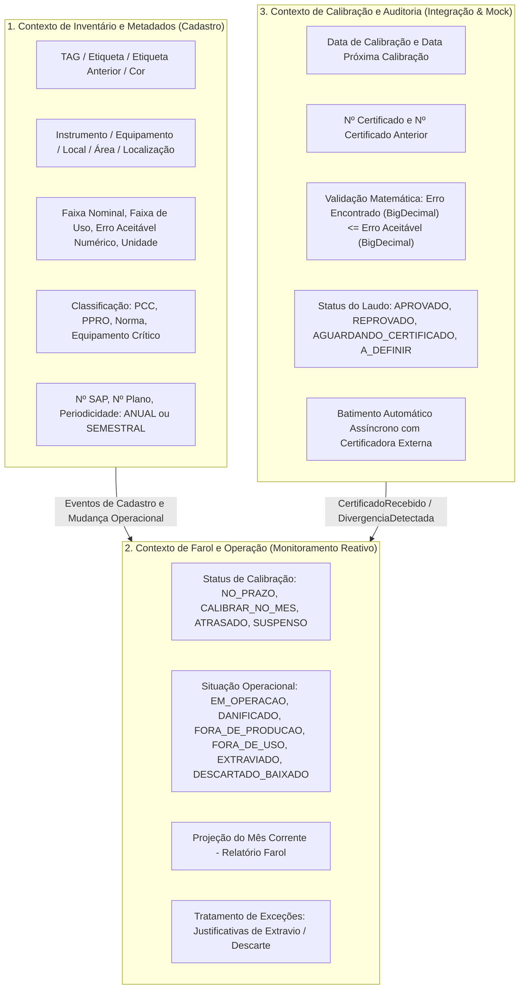

# 01 - Visão de Domínio e Modelo de Dados Legado

Este documento detalha o domínio metrológico e o mapeamento da planilha de controle manual atualmente utilizada na fábrica (**Registro de Calibração**), servindo como base canônica para a modelagem unificada do banco de dados, entidades de domínio e eventos do **FarolFlow**.

---

## 🏭 Unificação da Base (Fim das Planilhas Separadas)

No processo manual legado, a fábrica mantinha planilhas separadas por periodicidade (uma para **Semestral** e outra para **Anual**) com metadados fixos no cabeçalho (**Local** e **Empresa**).

No **FarolFlow**, todas as planilhas são **unificadas em uma única base centralizada**, transformando a **Periodicidade** (`ANUAL` ou `SEMESTRAL`) e o **Local/Planta** em atributos diretos de cada instrumento cadastrado.

---

## 📊 Mapeamento Detalhado dos Atributos (Dicionário de Dados)

| Atributo / Coluna | Tipo no Java | Descrição e Regras de Domínio | Exemplos de Dados |
| :--- | :---: | :--- | :--- |
| **Etiqueta (TAG)** | `String` (Único) | Identificador metrológico atual do instrumento na planta. Chave de negócio. | `BAL-0022`, `AER-0392`, `AG-0042` |
| **Etiqueta Anterior** | `String` (Nullable) | Histórico de rastreabilidade caso a TAG física tenha sido renumerada ou substituída. | `BAL-0022`, `AER-0392` |
| **Cor da Etiqueta** | `Enum / String` | Identificação visual rápida afixada fisicamente no instrumento para auditoria no chão de fábrica. | `Verde`, `Branca`, `Vermelha` |
| **Periodicidade** | `Enum` | Frequência de calibração do instrumento para cálculo automático do próximo vencimento (`+6` ou `+12` meses). | `ANUAL`, `SEMESTRAL` |
| **Instrumento** | `String` | Categoria ou tipo metrológico do dispositivo. | `Balança Digital`, `Chapa Aquecedora`, `PT-100`, `Manômetro` |
| **Local / Planta** | `String` | Unidade fabril à qual o instrumento pertence. | `Unidade Goiânia` |
| **Área** | `String` | Setor macro ou departamento responsável. | `Almoxarifado`, `Laboratório`, `Produção` |
| **Localização** | `String` | Ponto físico específico de instalação ou uso do equipamento. | `Almoxarifado Central`, `Envase 02`, `Linha 01` |
| **Equipamento** | `String` | Sistema maior ou máquina ao qual o instrumento está acoplado. | `Balança de Bancada`, `Túnel 3`, `Linha de Envase` |
| **Descrição** | `String` | Detalhamento técnico da função ou modelo do instrumento. | `Analisador de umidade infravermelho` |
| **Faixa Nominal** | `String` | Faixa nominal de medição suportada pelo equipamento segundo o fabricante. | `0 a 100g`, `-200 a 850°C`, `0 a 10 bar` |
| **Faixa de Uso** | `String` | Faixa operacional efetivamente utilizada no processo produtivo. | `0,5 a 4200g`, `40 a 450°C` |
| **PCC** | `Boolean` | Ponto Crítico de Controle (critério estrito de segurança/qualidade alimentar ou farmacêutica). | `true`, `false` |
| **PPRO** | `Boolean` | Programa de Pré-Requisitos Operacionais (normas de gestão de qualidade/segurança). | `true`, `false` |
| **Norma** | `Boolean` | Indica se o instrumento é exigência de norma regulatória compulsória. | `true`, `false` |
| **Equipamento Crítico** | `Boolean` | Indicador de criticidade direta para continuidade do processo fabril. | `true`, `false` |
| **Data de Calibração** | `LocalDate` | Data em que o ensaio metrológico foi efetivamente realizado pela prestadora. | `2026-07-15`, `2026-09-22` |
| **Data Próxima Calibração** | `LocalDate` | Data limite de validade da calibração (vencimento calculado/auditado do ciclo). | `2027-07-15`, `2027-03-22` |
| **Nº Certificado** | `String` | Número do laudo/certificado emitido pela certificadora ou status inicial. | `2026-3218`, `Instrumento Novo` |
| **Nº Certificado Anterior** | `String` (Nullable) | Número do certificado do ciclo imediatamente anterior para garantir cadeia de rastreabilidade. | `2025-4492` |
| **Erro Máximo Encontrado** | `BigDecimal` | Maior desvio numérico constatado durante os testes práticos de calibração. | `0.01`, `0.03` |
| **Erro Máximo Aceitável** | `BigDecimal` | Valor numérico estrito da tolerância máxima permitida (mesmo quando derivado de portaria, o usuário informa o valor numérico correspondente para permitir cálculo automático: `Erro Encontrado <= Erro Aceitável`). | `0.05`, `0.10`, `1.50` |
| **Unidade de Medida** | `String` | Grandeza de medição associada à faixa e aos erros metrológicos. | `kg`, `g`, `°C`, `bar`, `psi` |
| **Status do Laudo** | `Enum` | Avaliação técnica do certificado perante os limites aceitáveis. | `APROVADO`, `REPROVADO`, `AGUARDANDO_CERTIFICADO`, `A_DEFINIR` |
| **Correção** | `Boolean` | Indica se foi necessário aplicar fator de correção ou ajuste instrumental. | `true`, `false` |
| **Nº SAP** | `String` | Código do ativo ou plano de manutenção no ERP corporativo (SAP). | `65897857`, `54711865` |
| **Nº Plano** | `String` | Código do plano de calibração metrológico. | `IRI-8908379`, `IRI-VAL-9234` |
| **Empresa Prestadora** | `String` | Nome do laboratório/prestador que executou a calibração. | Nome da prestadora (Suporty Calibrações / Mock) |
| **Responsável por Validar** | `String` | Nome do colaborador/técnico da fábrica que conferiu ou homologou o certificado. | `NOME DO INSTRUMENTISTA / ANALISTA` |
| **Status de Calibração (Farol)** | `Enum` | Situação temporal calculada automaticamente pelo sistema com base na data de vencimento e situação operacional do ativo. | `NO_PRAZO`, `CALIBRAR_NO_MES`, `ATRASADO`, `SUSPENSO` |
| **Situação Operacional** | `Enum` | Disponibilidade física e operacional do equipamento na planta. | `EM_OPERACAO`, `DANIFICADO`, `FORA_DE_PRODUCAO`, `FORA_DE_USO`, `EXTRAVIADO`, `DESCARTADO_BAIXADO` |
| **Observação** | `Text` | Campo aberto para registro de anomalias, referências a portarias (ex: Portaria 157/2022), motivos de extravio, descarte ou notas de campo. | Texto livre |

---

## 🚦 Detalhamento dos Enums de Status

Para eliminar a sobrecarga de responsabilidades que existia na coluna única da planilha legada, o FarolFlow divide os estados em três dimensões claras e complementares:

### 1. `StatusLaudo` (Conformidade Metrológica do Certificado)
- `APROVADO`: `Erro Máximo Encontrado <= Erro Máximo Aceitável`.
- `REPROVADO`: `Erro Máximo Encontrado > Erro Máximo Aceitável` (instrumento fora dos padrões de tolerância).
- `AGUARDANDO_CERTIFICADO`: Instrumento já foi ensaiado em campo pela prestadora, aguardando o envio do laudo final.
- `A_DEFINIR`: Instrumento recém-cadastrado em processo de triagem ou calibração inicial.

### 2. `StatusCalibracao` (Mecanismo Temporal do Farol)
- `NO_PRAZO` (🟢 Verde): Equipamento `EM_OPERACAO`, com calibração válida e vencimento posterior ao mês corrente.
- `CALIBRAR_NO_MES` (🟡 Amarelo / Projeção Farol): Equipamento `EM_OPERACAO` com vencimento previsto dentro do mês de apuração da campanha.
- `ATRASADO` (🔴 Vermelho): Equipamento `EM_OPERACAO` cuja data de vencimento foi ultrapassada sem novo registro de calibração válida (alerta crítico para auditoria).
- `SUSPENSO` (⚪ Cinza / Congelado): O ciclo do Farol é pausado automaticamente sempre que a `SituacaoOperacional` for diferente de `EM_OPERACAO` (ou seja: `DANIFICADO`, `FORA_DE_PRODUCAO`, `FORA_DE_USO`, `EXTRAVIADO` ou `DESCARTADO_BAIXADO`), evitando falsos alertas de atraso na fábrica.

### 3. `SituacaoOperacional` (Disponibilidade e Gestão de Ativos)
- `EM_OPERACAO`: Ativo em funcionamento regular na linha fabril (único estado que mantém o Farol ativo).
- `DANIFICADO`: Equipamento com falha física que impede seu uso temporário (suspende o ciclo do Farol até o reparo).
- `FORA_DE_PRODUCAO`: Linha ou área inoperante temporariamente por motivos de manutenção ou parada programada (suspende o Farol).
- `FORA_DE_USO`: Instrumento reserva ou desmobilizado em estoque (suspende o Farol).
- `EXTRAVIADO`: Instrumento portátil não localizado (suspende o Farol e exige justificativa formal anexada para auditoria).
- `DESCARTADO_BAIXADO`: Instrumento condenado metrologicamente ou avariado retirado definitivamente do inventário com evidência documental (suspende o Farol).

---

## 🧠 Análise de Domínio para a Arquitetura do FarolFlow

Ao analisar os 32 atributos mapeados para a base unificada, observamos que o domínio se divide naturalmente em **três contextos delimitados (*Bounded Contexts*)**, perfeitos para a arquitetura de microsserviços em Java/Spring Boot:

---

## 📌 Próximos Passos
1. Transformar essas regras no arquivo `02_requisitos.md` (separando Requisitos Funcionais e Critérios de Aceite).
2. Definir as regras de negócio em `03_regras_de_negocio.md` (como o sistema calcula se está `NO_PRAZO`, `CALIBRAR_NO_MES`, `ATRASADO` ou `SUSPENSO`, e como detecta divergência matemática e de datas entre os dados do Mock e a base interna).
